# Architecture and source map

dnstt-turbo carries many TCP streams over one encrypted multiplexed session,
over KCP, inside DNS messages. Keep these layers distinct when debugging:
a healthy outer TCP socket does not prove a healthy encrypted session, and a
ready session does not prove the remote TCP service is reachable.

## Data path

```mermaid
flowchart LR
    A[Local TCP application] --> C[Client local listener]
    C --> M[smux streams]
    M --> N[Noise authenticated encryption]
    N --> K[KCP reliable byte stream]
    K --> D[DNS queries and TXT replies]
    D --> T[TCP / UDP / DoH / DoT carrier]
    T --> S[Server DNS packet connection]
    S --> R[KCP / Noise / smux]
    R --> U[Configured upstream TCP service]
```

For UDP/DoH/DoT, the resolver forwards queries to the authoritative tunnel
server over UDP. Direct `-tcp` connects to the fork's own TCP listener.
The fork's optional private EDNS upload encoding is a direct-TCP extension.
Downstream responses can bundle multiple whole KCP packets into TXT data.

The server advertises a public key; the client pins that key. The Noise
handshake authenticates the server, not the client's identity. The backend
service must provide any application-level access control it requires.

## Source ownership

| Package / file | Responsibility |
|---|---|
| [dnstt-client/main.go](../dnstt-client/main.go) | CLI, transport selection, KCP/Noise/smux setup, local connections, session rebuilding |
| [dnstt-client/dns.go](../dnstt-client/dns.go) | DNS packet encoding/decoding, query IDs, polling, delivery feedback and pacing integration |
| [dnstt-client/tcp.go](../dnstt-client/tcp.go) | Direct TCP framing, carrier redial and connection lifetime |
| [dnstt-client/http.go](../dnstt-client/http.go), [tls.go](../dnstt-client/tls.go), [utls.go](../dnstt-client/utls.go) | DoH/DoT transport and TLS fingerprint handling |
| [dnstt-client/adaptive.go](../dnstt-client/adaptive.go), [ratesfile.go](../dnstt-client/ratesfile.go) | Adaptive settings and optional rate snapshots |
| [dnstt-server/main.go](../dnstt-server/main.go) | Key handling, DNS admission, packet queues, sessions and backend TCP forwarding |
| [dnstt-server/tcp.go](../dnstt-server/tcp.go) | TCP listener, per-carrier reply FIFO, framing, deadlines and shutdown |
| [dns/](../dns) | DNS names, questions, records and wire/TXT encoding |
| [turbotunnel/](../turbotunnel) | PacketConn adapter, peer queues, bounded remote map and expiry |
| [noise/](../noise) | Noise handshake, encrypted record framing and terminal failure state |
| [bbr/](../bbr) | Optional delivery estimates, bounded adaptive windows and upload pacing |
| [fairqueue/](../fairqueue) | Optional per-stream scheduling and backpressure in front of smux |
| [cake/](../cake) | Cobalt, deficit shaping and rate-dependent parameters used by fairqueue |
| [diagnostics/](../diagnostics) | Health events, counters and rotating log output |
| [third_party/smux/](../third_party/smux) | Pinned multiplexing dependency with local stream-registration fix |

## Client lifecycle

1. `main` validates settings, selects a carrier, wraps it in `DNSPacketConn`,
   and invokes `run`. A session-loss result triggers a fresh tunnel attempt.
2. `run` owns the local listener, KCP connection, Noise handshake, smux session,
   health loop, and optional adaptive/fair scheduling state. A handshake timer
   bounds startup. The `begin session` log precedes authentication.
3. `serveLocalStreams` accepts local TCP connections; `handle` opens a smux
   stream and copies both directions, preserving the close/cancellation rules.
4. A Noise terminal-failure signal closes smux. A failed stream-open operation
   also closes the unusable session so the outer loop can rebuild it.

Carrier redial and session rebuilding solve different failures. A carrier
interruption may be repaired by KCP retransmission. Once either endpoint has
lost encrypted/session state, a fresh session is required. Established local
application streams cannot be transparently restored after session loss;
applications reconnect. The current implementation can briefly rebind its local
listener during recovery.

## Server lifecycle

Each listener runs its own DNS packet connection, queue adapter and KCP listener.
UDP and TCP can share the same key/domain/backend configuration while using
separate packet/session spaces and response limits.

`recvLoopContext` parses and admits queries, extracts upstream packets, and
passes admitted requests to `sendLoop`. Data packets enter `QueuePacketConn`
for KCP. `acceptSessions` configures each KCP connection; `acceptStreams`
performs Noise/smux setup; `handleStream` dials the configured TCP backend.

`sendLoop` pulls available downstream KCP packets, bundles those that fit in a
DNS reply, and retains a packet for a later query when it cannot fit now.
`responseFor`, `computeMaxEncodedPayload`, and the response-cap helpers enforce
DNS size constraints. Admission rejects a client's advertised cap if it cannot
carry the listener's whole configured segment. Error responses are bounded too.

## Queues, ownership and backpressure

- `QueuePacketConn` converts packet callbacks into the `net.PacketConn` seam
  used by KCP. Queued bytes have owned storage across asynchronous consumers.
- `RemoteMap` bounds peer count and aggregate queue slots. Nonallocating
  `ExistingQueues` lookups serve empty polls without creating window-sized
  queues for arbitrary unauthenticated client IDs. This budget is not a total
  process-memory or authentication guarantee.
- Each direct TCP carrier owns a bounded ordered reply writer. Its count and
  byte limits include admitted work. Queue-full admission returns a temporary
  error for the new, wholly unsent datagram; already admitted replies remain
  queued. KCP can retransmit the missing data when the client polls again.
- Actual TCP write errors, disconnects, and bounded write deadlines terminate
  the affected carrier. One slow reader must not block another carrier's
  global reply path. Connection identity prevents an old reader's cleanup from
  closing a replacement writer.
- Noise read/write/integrity failures permanently poison that record stream.
  Short writes are failures, not successful record transmission.
- smux registers streams before publishing SYN so early peer frames cannot
  arrive for an unregistered local stream. See its
  [patch rationale](../third_party/smux/PATCHES.md).

For optional scheduling contracts, read [Scheduling](SCHEDULING.md). For test
seams and regression names, read [Testing](TESTING.md).

## Scope of refactoring

The client/server `main` packages intentionally retain upstream's layout and
wire-layer relationships. The simulation harness freezes their source and
checks exact textual seams; moving functions requires updating that harness
and running it, not just passing package tests. Avoid a broad file/package
shuffle as a cleanup task. Extract a module only when it removes actual
duplication or provides a clearer tested ownership seam.
